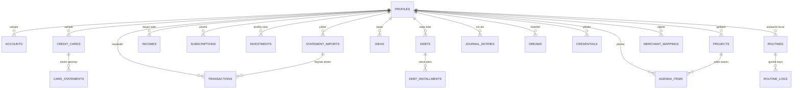

# 🏛️ Pusula — Domain Model & Varlık İlişkileri

Bu döküman, Pusula sistemindeki temel varlıkları (Entities), bu varlıkların birbirleriyle olan kontrollü ilişkilerini ve verilerin nasıl depolanıp nasıl türetildiğini (Stored vs. Derived) tanımlar.

---

## 1. Varlık İlişki Diyagramı (Entity Relationship)

---

## 2. Temel Varlıklar ve Alan Tanımları

### 1. `Accounts` (Hesaplar & Birikim / Damla Getiri)
- **Amaç:** Kullanıcının vadesiz banka, nakit kasa ve günlük/aylık getiri üreten birikim hesaplarını tutar. Bakiyeler manuel olarak veya birikim motoru üzerinden kontrol edilir.
- **Temel Alanlar:**
  - `id`: UUID (PK), `user_id`: UUID (FK)
  - `name`: Text ("Enpara Vadesiz", "Günlük Birikim")
  - `type`: Enum (`Vadesiz`, `Nakit`, `Yatırım`, `Birikim`)
  - `balance`: Numeric(12,2) (Güncel bakiye)
  - `currency`: Enum (`TRY`, `USD`, `EUR`, `GBP`)
  - `savings_principal`, `annual_yield_rate`, `yield_type`, `yield_start_date`: Birikim ("Damla") getiri motoru parametreleri.

### 2. `CreditCards` & `CardStatements` (Kredi Kartları ve Ekstre Geçmişi)
- **Amaç:** Aktif kredi kartı limitlerini, güncel/dönem borçlarını, kesim/son ödeme günlerini ve aylık ekstre değişim trendlerini (`prev_debt`, `change_amount`, `change_pct`) tutar.

### 3. `Transactions` (İşlem Defteri — Hareketler)
- **Amaç:** Banka/kart ekstrelerinden içe aktarılan veya manuel girilen finansal hareketlerin kaydıdır.
- **Temel Alanlar:**
  - `date`, `account_or_card`, `type` (`Harcama`, `Kart Ödemesi`, `Gelir`, `Tahsilat`, `Finansman/Masraf`, `İade`, `Borç Ödemesi`, `Nakit Avans`, `Transfer`)
  - `amount`: Numeric(12,2)
  - `analysis_group`: Enum (`Kişisel`, `İş`, `Finansman`, `Hariç`)
  - `merchant`: Normalize işyeri adı
  - `recurrence`: Taksit veya düzenlilik bilgisi ("Taksit (3/6)")
  - `import_id`: UUID (FK ➔ `statement_imports`)

### 4. `Debts` & `DebtInstallments` (Borçlar, Alacaklar ve Taksit Planı)
- **Amaç:** Şahıs/kurum borçlarını, kesin alacakları ve vadeli borç taksit planlarını (`debt_installments`) banka hesap bakiyelerinden bağımsız olarak takip eder.
- **Temel Alanlar:**
  - `debts`: `type` (`Borç`, `Alacak`), `category`, `person_or_entity`, `principal`, `past_payments`, `remaining`, `status` (`Açık`, `Kapatıldı`), `due_date`.
  - `debt_installments`: `debt_id`, `installment_no`, `due_date`, `amount`, `status` (`Bekliyor`, `Ödendi`, `Gecikti`), `paid_at`.

### 5. `Incomes` (Beyan Edilen Gelirler)
- **Amaç:** Maaş, freelance hakediş, kira veya temettü gibi düzenli (`Düzenli`) ve tek seferlik (`Tek Seferlik`) gelir kalemlerini çoklu döviz desteğiyle tutar.

### 6. `Subscriptions` (Abonelikler & Sabit Yük)
- **Amaç:** Aylık/yıllık tekrarlayan SaaS, fatura ve lisans ödemelerini (`TRY`, `USD`, `EUR`, `GBP`), ödeme günlerini ve devam/iptal kararlarını yönetir.

### 7. `Investments` (Yatırım Portföyü)
- **Amaç:** Altın, döviz, hisse senedi, fon ve kripto varlıklarının miktar, maliyet (`avg_cost`) ve güncel piyasa fiyatlarını (`current_price`) takip eder.

### 8. `Projects` & `Ideas` (Proje Çalışma Masası ve Fikir Havuzu)
- **Amaç:** Geliştirilen projelerin yaşam döngüsünü (`Fikir`, `Planlama`, `Geliştirmede`, `Canlı`, `Arşiv`), Markdown şartnamesini (`spec_markdown`) ve çalışma bağlantılarını finansal muhasebeden bağımsız, yalın bir odak masası olarak yönetir.

### 9. Yaşam, Odak ve Güvenlik Varlıkları
- **`AgendaItems`:** Günlük yapılacaklar, proje odak seansları ve Pomodoro/kronometre süre kayıtları (`duration_minutes`).
- **`Routines` & `RoutineLogs`:** Günlük alışkanlıklar, 3 seviyeli tamamlama skoru, seri (streak) ve mola (`is_frozen`) durumu.
- **`JournalEntries`:** Markdown destekli günlük seyir defteri.
- **`Dreams`:** Kısa, orta ve uzun vadeli vizyon hedefleri.
- **`Credentials`:** İstemci tarafında `PBKDF2 + AES-GCM 256-bit` ile şifrelenen kimlik ve parola kasası.

---

## 3. Depolanan Veri vs. Anlık Türetilen Metrikler (Calculated/Derived)

Veri tutarsızlığını önlemek için özet metrikler saf motorlar (`finance-engine.ts`, `savings-engine.ts`, `life-md-engine.ts`) tarafından kuruş hassasiyetiyle anlık hesaplanır:

1. **Net Varlık (Net Worth):**
   $$\text{Net Varlık} = \sum \text{Accounts.balance} + \sum \text{Investments} + \sum \text{Debts(Alacak).remaining} - \left( \sum \text{CreditCards.current\_debt} + \sum \text{Debts(Borç).remaining} \right)$$

2. **Aylık Bütçe & Nakit Akışı Dengesi:**
   $$\text{Kalan Serbest Bütçe} = \text{Aylık Beyan Edilen Gelir} - \text{Sabit Taahhütler (Abonelik + Bu Ayın Taksitleri)} - \text{Değişken Harcama Yükü}$$

3. **6 Aylık Planlı Nakit Yükü:**
   $$\text{Ay } N \text{ Yükü} = \sum \text{Aktif Abonelikler} + \sum \text{Kredi Kartı Taksitleri} + \sum \text{Borç Taksit Planı (`debt\_installments`)}$$

4. **Çalışma Masası Kapasite Durumu (Focus Gate):**
   $$\text{Kapasite Dolu} \iff \text{Count}(\text{Projects.status} \in \{\text{'Planlama'}, \text{'Geliştirmede'}\}) \ge 2$$
