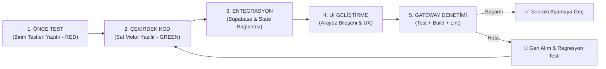

# 🧭 Pusula — Master Geliştirme Planı, Test Matrisi & Gateway Protokolü

**Mimari Versiyon:** 2.4.0 (Decoupled & Strict Gateway Architecture)  
**Hedef Repo:** `github.com/keskinEvren/pusula`

---

## 1. Geliştirme Metodolojisi (Strict TDD & Gateway Loop)

Pusula'nın geliştirilmesinde izlenecek adımlar:



1. **Önce Test (Test-First):** İlgili fonksiyonun iş mantığı ve sınır durumları (edge cases) için birim testleri yazılır.
2. **Saf Çekirdek Kod (Core Logic):** UI veya DB bağımlılığı olmadan testleri geçirecek saf fonksiyonlar kodlanır.
3. **Entegrasyon & State (Integration):** Supabase istemcisi ve yerel state yönetimi bağlanır.
4. **Kullanıcı Arayüzü (UI):** Bileşenler ve sayfalar bağlanır.
5. **Gateway Denetimi:** Testler, lint ve build komutları çalıştırılır. Gateway geçilmeden sonraki aşamaya başlanmaz.

---

## 2. 6 Aşamalı Kalite Kapıları (Quality Gateways)

```
┌────────────────────────────────────────────────────────────────────────┐
│                   PUSULA KALİTE KAPILARI (GATEWAYS)                    │
├────────────┬─────────────────────────────┬─────────────────────────────┤
│ Gateway 1  │ 🗄️ Veritabanı & Model       │ 18+ Tablo, RLS, RPC'ler     │
│ Gateway 2  │ 🧮 Saf Finans & Birikim     │ Kuruş Hassasiyeti, Damla    │
│ Gateway 3  │ 📄 Ekstre Ayrıştırıcı       │ Glif Onarımı, Sütun Taksit  │
│ Gateway 4  │ 📊 Kokpit & Bütçe Dengesi   │ Net Varlık, Gelir/Gider     │
│ Gateway 5  │ 🚀 Proje Çalışma Masası     │ Odak Kapasitesi, Markdown   │
│ Gateway 6  │ 🚀 Üretim Derlemesi         │ Next.js Build, 0 Hata, Lint │
└────────────┴─────────────────────────────┴─────────────────────────────┘
```

---

### 🟢 Gateway 1: Veritabanı & Model Doğrulaması
- **Kapsam:** 
  - PostgreSQL tabloları (`profiles`, `accounts`, `credit_cards`, `card_statements`, `debts`, `debt_installments`, `incomes`, `subscriptions`, `investments`, `statement_imports`, `transactions`, `projects`, `ideas`, `agenda_items`, `routines`, `routine_logs`, `journal_entries`, `dreams`, `credentials`, `merchant_mappings`).
  - Row Level Security (RLS) politikaları ve atomik RPC fonksiyonları (`import_statement_bundle`, `rollback_statement_import`, `list_transactions_page`).
- **Doğrulama Kriteri:**
  - TypeScript tip tanımları (`types/database.ts`) tablolarla birebir eşleşmeli.
  - Derleme sırasında tip uyuşmazlığı hatası olmamalı.

---

### 🟢 Gateway 2: Saf Finans & Birikim Motoru (`src/lib/finance-engine.ts` & `src/lib/savings-engine.ts`)
- **Kapsam:**
  - **Net Varlık:** $\text{Net Varlık} = (\text{Nakit} + \text{Yatırım} + \text{Alacak}) - (\text{Kart Borcu} + \text{Diğer Borç})$.
  - **Aylık Bütçe Dengesi:** $\text{Aylık Beyan Edilen Gelir} - \text{Sabit Taahhütler (Abonelik + Bu Ayın Taksitleri)} - \text{Değişken Yük}$.
  - **6 Aylık Nakit Yükü & Taksit Projeksiyonu:** $\sum \text{Abonelikler} + \sum \text{Kredi Kartı Taksitleri} + \sum \text{Borç Taksit Planı (`debt\_installments`)}$.
  - **Bağımsız Borç & Taksit Yönetimi:** Borç/alacak ve vadeli taksit planları banka hesap bakiyelerini gizli yan etkilerle bozmadan kendi içinde senkronize çalışır; aynı gün düşen taksitler (`mergeSameDayInstallments`) birleştirilir.
  - **Birikim ("Damla") Getiri Motoru:** Günlük net getiri, biriken toplam getiri ve ay sonu projeksiyonu.
  - **Kredi Kartı Dönem Trendi:** $\Delta = \text{Yeni Borç} - \text{Eski Borç}$, % Değişim, ▲ Kırmızı / ▼ Yeşil trend.
- **Doğrulama Kriteri:**
  - Vitest ile tüm finans ve birikim birim test senaryoları hatasız geçmelidir.
  - IEEE-754 floating point hatası (`0.1 + 0.2 = 0.30000000000000004`) %100 engellenmiş olmalıdır.

---

### 🟢 Gateway 3: Hibrit Ekstre Ayrıştırıcı & Türkçe Onarım Motoru (`src/lib/parser/*`)
- **Kapsam:**
  - **%100 Client-Side:** Sunucuya dosya yüklemeden tarayıcıda `pdfjs-dist` ile metin çıkarma ve X koordinatına göre yatay sütun sıralama.
  - **Glif Kaybı Onarımı (`turkish-cleaner.ts`):** Türkçe karakter restorasyonu.
  - **Taksit Sütun Ayrıştırması:** Parantez içindeki ana tutar yerine döneme ait taksit tutarının ve taksit bilgisinin (`4/6`) yakalanması.
  - **Borç Ödemesi İzolasyonu:** `Ödeme - Enpara` satırlarının `type: 'Kart Ödemesi'`, `group: 'Hariç'` ve varsayılan olarak `selected: false` yapılması.
  - **İnteraktif Onay Ekranı (Review Flow):** Tam hareket veya sadece özet (`summary_only`) aktarım desteği ve atomik geri alma (rollback).

---

### 🟢 Gateway 4: Kokpit & Bağımsız Finans Modülleri
- **Kapsam:**
  - **Kokpit (`/`):** Net Varlık, Hazır Para, Kart Borçları, Kesin Alacaklar, Aylık Bütçe Dengesi ve 6 Aylık Nakit Yükü.
  - **Hesaplar (`/accounts`) & Kredi Kartları (`/cards`):** Manuel bakiye/borç kontrolü, Damla birikim getiri motoru ve ekstre geçmişi değişim trendi (▲/▼).
  - **Borç & Alacak (`/debts`):** Düz borç/alacak ve vadeli taksit planlayıcı (`debt_installments`).
  - **Gelirler (`/incomes`) & Abonelikler (`/subscriptions`):** Döviz kuru dönüşümlü gelir beyanı ve 6 aylık nakit yükü matrisi.

---

### 🟢 Gateway 5: Yalın Proje Çalışma Masası & Odak Kapasitesi
- **Kapsam:**
  - **Çalışma Masası (`/projects`):** `Fikir` ➔ `Planlama` ➔ `Geliştirmede` ➔ `Canlı` ➔ `Arşiv`.
  - **Kapasite Kapısı (Focus Gate):** Aktif geliştirme $\ge 2$ olduğunda uyarı paneli.
  - **Proje Detayı (`/projects/[slug]`):** Markdown şartname (`spec_markdown`), repo/canlı bağlantılar ve ajanda odak seansları.
  - **Fikir Havuzu (`/ideas`):** Fikir kuluçkası ve tek tıkla projeye dönüştürme.

---

### 🟢 Gateway 6: Üretim Derlemesi & Kod Kalitesi
- **Kapsam:**
  - TypeScript derleme doğrulaması (`npm run typecheck`).
  - Next.js App Router üretim derlemesi (`npm run build`).
  - ESLint kod kalitesi denetimi (`npm run lint`).
  - Tüm test süitinin eksiksiz geçmesi (`npm run test` — 34 test dosyası, 520+ test).
