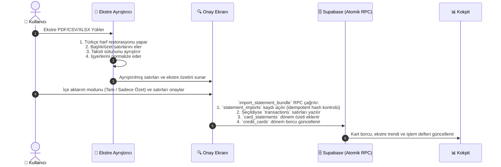

# ⚡ Pusula — Sistem Dinamikleri & Olay Akışları (System Dynamics)

Bu döküman, Pusula'daki modüllerin **bağımsız, öngörülebilir ve kontrollü** çalışma akışlarını detaylandırır. Modüller arası gizli yan etkiler (otomatik çapraz bakiye düşümleri veya zorunlu proje maliyet köprüleri) kaldırılmış; her akış kendi sorumluluk alanında atomik ve şeffaf hale getirilmiştir.

---

## 🔄 1. Olay: Ekstre PDF/CSV Yüklendiğinde (Statement Ingestion)

Kullanıcı ekstre yüklerken iki farklı moddan birini seçebilir: **Tam Hareket İçe Aktarımı** veya **Sadece Ekstre Özeti (`summary_only`)**.



### Temel Kurallar:
1. **Çift Sayım Koruması (No Double-Counting):** Ekstredeki `Ödeme - Enpara` gibi borç ödeme satırları `Kart Ödemesi` (`Hariç`) olarak işaretlenir. Böylece hem kart borcu hem de yapılan ödeme ikinci kez harcama olarak sayılmaz.
2. **Kredi Kartı Trendi:** Kartın bir önceki ekstre borcu ile yeni ekstre borcu kıyaslanır; aradaki fark (▲ Artış / ▼ Azalış) ve yüzde değişimi hesaplanarak `card_statements` geçmişine işlenir.
3. **Atomik Geri Alma (Rollback):** İçe aktarılan bir ekstre geri alındığında (`rollback_statement_import`), yalnızca o içe aktarıma ait işlemler silinir ve kartın önceki ekstre durumu güvenle geri yüklenir.

---

## 💳 2. Olay: Hesap ve Kredi Kartı Bakiye Yönetimi (Manuel Kontrol & Damla Motoru)

Hesap bakiyeleri (`accounts`) ve kredi kartı borçları (`credit_cards`), diğer modüllerin yan etkilerinden bağımsız olarak doğrudan kullanıcı kontrolündedir:

1. **Manuel Bakiye ve Borç Güncelleme:**
   - Kullanıcı banka/nakit hesap bakiyelerini veya kredi kartı güncel borçlarını doğrudan ilgili modülden günceller.
   - Kredi kartı ödeme kaydı girildiğinde, başka bir banka hesabından otomatik bakiye düşümü yapılmaz; kart borcu ve hesap bakiyesi kullanıcının gerçek banka durumuna göre bağımsız tutulur.
2. **Birikim Hesapları & "Damla" Günlük Getiri Motoru:**
   - `Birikim` türündeki hesaplarda kullanıcı ana para (`savings_principal`), yıllık net getiri oranı (`annual_yield_rate`) ve başlangıç tarihini (`yield_start_date`) tanımlar.
   - Sistem (`savings-engine.ts`), geçen gün sayısına göre biriken net getiriyi, günlük damla hızını ve ay sonu projeksiyonunu kuruş hassasiyetinde hesaplar.

---

## 🤝 3. Olay: Borç, Alacak ve Taksit Planı Yönetimi (`debts` & `debt_installments`)

Borç ve alacak modülü, banka hesap bakiyelerinden bağımsız olarak kendi iç bütünlüğüyle çalışır:

```mermaid
flowchart TD
    A["🤝 Borç / Alacak İşlemi"] --> B{"Kayıt Yapısı Nedir?"}

    B -->|Düz Borç / Alacak| C["`debts.past_payments` Artar<br/>`debts.remaining` Düşer"]
    B -->|Taksit Planlı Borç| D["`debt_installments` Taksit Satırı `Ödendi` İşaretlenir"]

    D --> E["Kalan Açık Taksitlerin Toplamı `debts.remaining` Olarak Senkronize Edilir"]
    C --> F{"Kalan Bakiye 0 mı?"}
    E --> F
    F -->|Evet| G["Durum: `Kapatıldı`"]
    F -->|Hayır| H["Durum: `Açık`"]
```

- **Aynı Gün Taksit Birleştirme (`mergeSameDayInstallments`):** Aynı borç altında aynı vade gününe düşen taksit kalemleri otomatik birleştirilerek takip karmaşası önlenir.
- **Bağımsız Bakiye:** Bir borç taksiti ödendiğinde veya alacak tahsil edildiğinde yalnızca ilgili borç/alacak kaydının kalan tutarı (`remaining`) güncellenir; vadesiz hesap bakiyelerine otomatik müdahale edilmez.

---

## 📊 4. Olay: Aylık Bütçe Dengesi & 6 Aylık Nakit Yükü Projeksiyonu

Kokpit (`/`), kullanıcının aylık finansal dengesini beyan edilen gelirler, sabit taahhütler ve değişken yük üzerinden hesaplar:

$$\text{Aylık Serbest Bütçe} = \text{Aylık Net Gelir} - \text{Sabit Taahhütler (Abonelik + Bu Ayın Taksitleri)} - \text{Değişken Yük}$$

1. **Beyan Edilen Gelirler (`incomes`):** Düzenli (maaş, kira vb.) ve tek seferlik gelirler, döviz kuru dönüşümü (`USD`, `EUR`, `GBP` ➔ `TRY`) destekli olarak aylık net geliri oluşturur.
2. **6 Aylık Planlı Nakit Yükü (`projectSixMonthCashLoad`):**
   - Aktif abonelikler (`subscriptions`) + kredi kartı devam eden taksitleri + borç taksit planı (`debt_installments`) birleştirilerek gelecek 6 ayın nakit çıkış projeksiyonu oluşturulur.
   - Kredi kartı üzerinden ödenen abonelikler ve taksitler, kart ekstresiyle çift sayılmaması için ayrıştırılır.

---

## 🚀 5. Olay: Proje Çalışma Masası, Ajanda & AI Bağlamı (`life.md`)

1. **Çalışma Masası Kapasite Kapısı (Focus Gate):**
   - `Planlama` ve `Geliştirmede` durumundaki aktif projelerin toplamı en fazla **2** olabilir (`checkProjectCapacity`).
   -Projeler finansal işlemlerden tamamen bağımsızdır; odak noktası Markdown şartname (`spec_markdown`), repo/canlı bağlantılar ve üretim takibidir.
2. **Ajanda & Zamanlayıcı (`agenda_items`):**
   - Günlük görevler bir projeye bağlanabilir, Pomodoro veya kronometre ile odak süresi (`duration_minutes`) kaydedilir ve yarım kalan görevler tek tıkla bugüne taşınabilir.
3. **AI Bağlam Motoru (`life-md-engine.ts`):**
   - Kullanıcının tüm modüllerdeki güncel durumu (net varlık, hesaplar, kartlar, borçlar, gelirler, projeler, rutinler, hedefler) tek bir yapılandırılmış `life.md` dokümanına dönüştürülerek yapay zekâ araçlarına bağlam olarak verilebilir.
